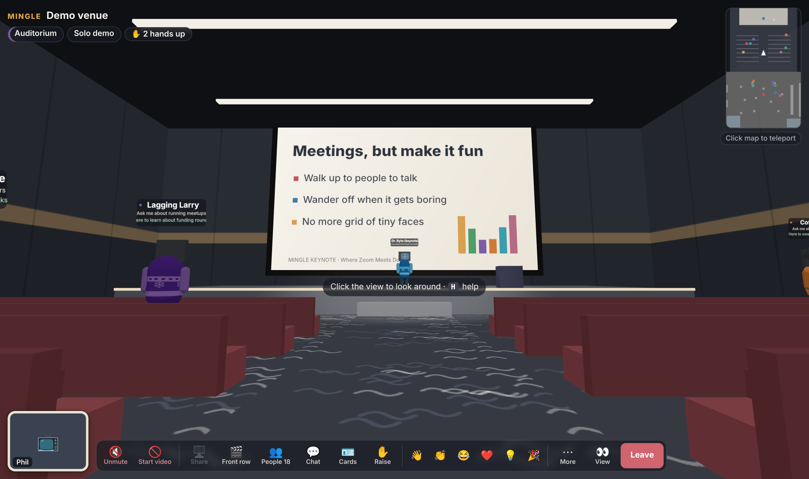
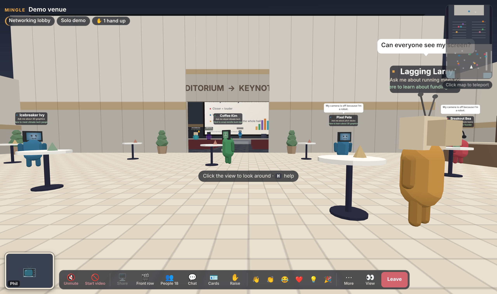
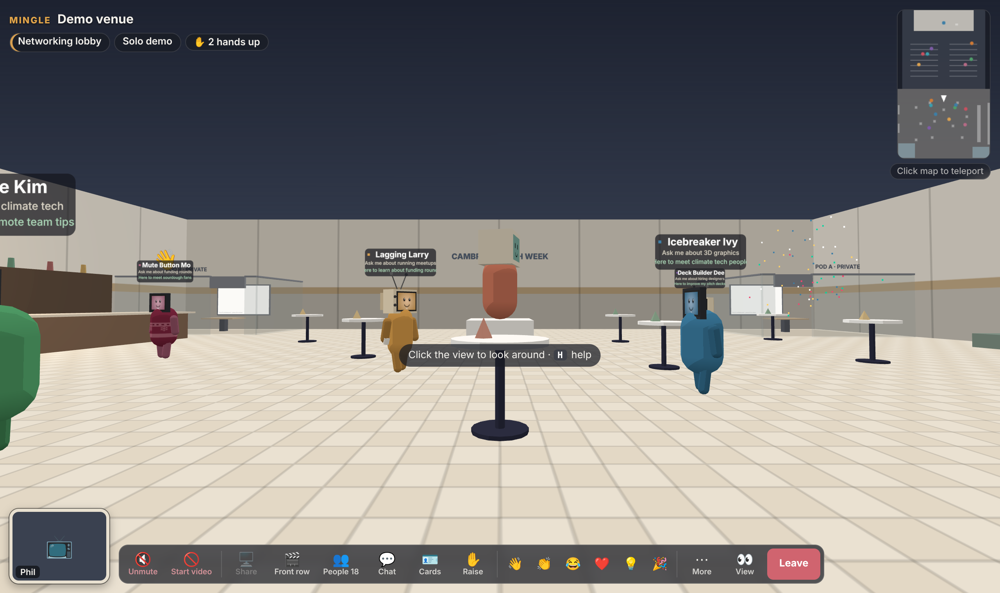
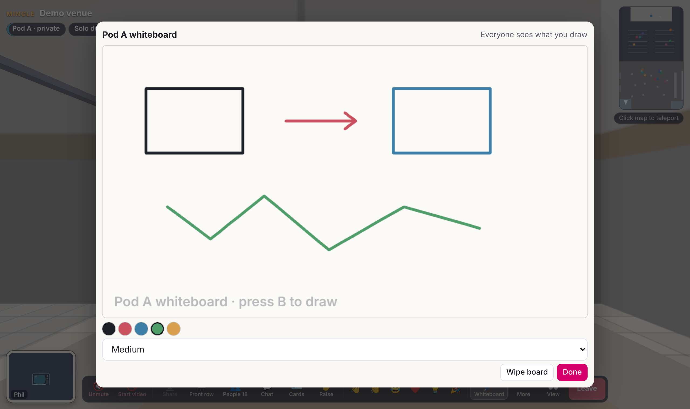
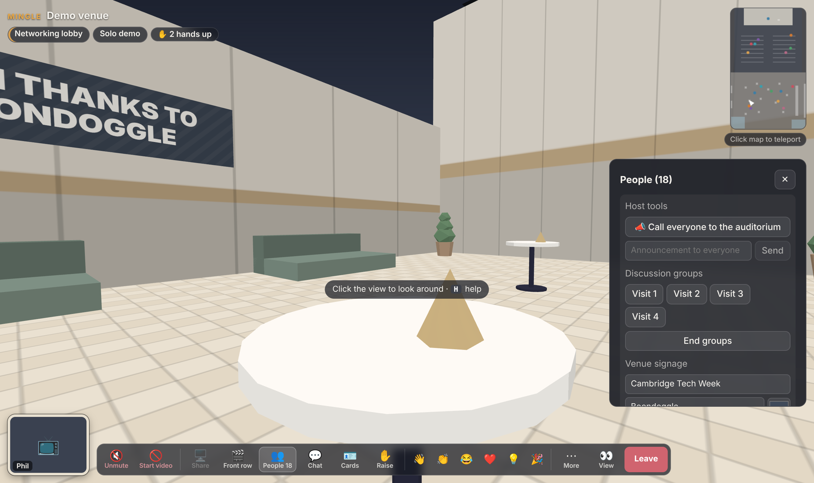
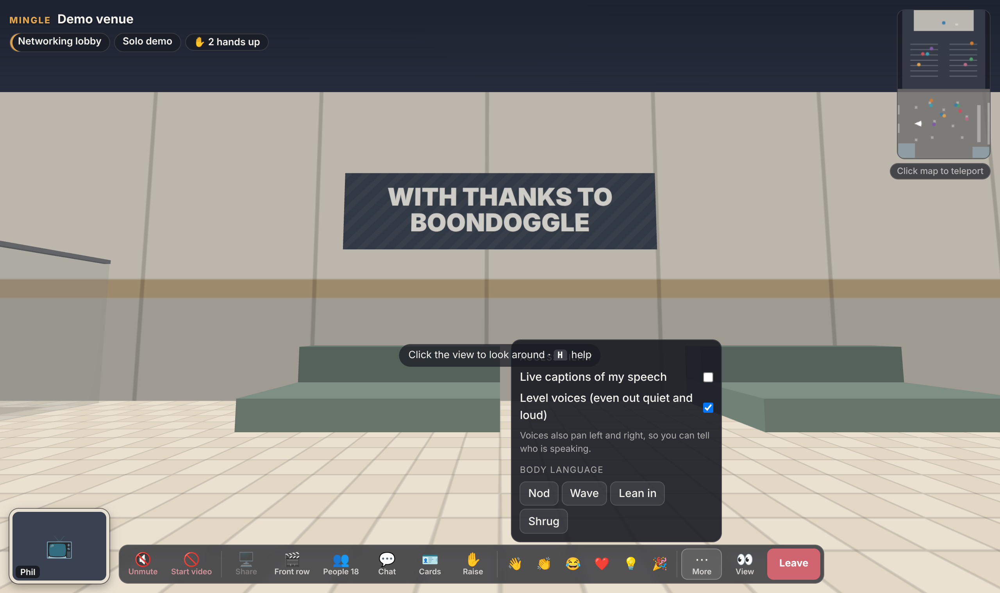

# Mingle · Where Zoom Meets Doom

Mingle is a video meeting you can walk around in. Everyone is a first-person, telly-headed avatar
with their own webcam as the face on the screen. Wander a networking lobby and talk to whoever you
walk up to, head through the big doors to catch a keynote on a cinema-sized screen, and pelt your
colleagues with (harmless) confetti.





## What you can do

**Get around**
- **Walk around like an FPS.** WASD to move, mouse to look, Shift to sprint, Space to jump, V for a third-person view.
- **Teleport.** Click the map to jump anywhere, or press Go next to someone in the People list to land beside them.
- **Familiar controls.** Mute, video, share, people, chat and leave sit in a bottom bar like any meeting app; first-run tips teach the rest one at a time.

**Meet people**
- **Your face on a telly.** Your webcam is the picture on your avatar's CRT head. Camera off? You get a cartoon face that blinks and talks.
- **Proximity voice.** People get louder as you approach and fade as you walk away, panned left and right so you can tell who spoke. Many conversations can happen in one room at once.
- **Every voice heard.** Voice levelling evens out quiet and loud speakers (on by default, under More).
- **Name tags that start conversations.** "Ask me about…" and "Here to…" float over everyone's head.
- **Matchmaking.** Mingle nudges you towards people who can help with what you're here for, with a "Take me there" button.
- **Business cards.** Press E next to someone to hand over your card; export everything you collect as vCards or CSV.
- **Soundproof pods** in the back corners, each with a shared whiteboard (press B to draw).
- **Body language.** 7 nod, 8 wave, 9 lean in, 0 shrug; 1 to 6 float an emoji; Enter to chat.
- **Live captions** of your own speech appear over your head and in the chat (Chrome and Edge).
- **Make it yours.** Height, build, retro or flat-screen telly, and a conversation starter: coffee mug, festive jumper, headphones or a conference lanyard.

**Watch a talk**
- **Keynotes.** Step onto the stage and your camera fills the big screen and your mic reaches every seat. Press P to share your screen instead. The audience is hushed while someone presents.
- **Front-row view.** Press F from anywhere to see the big screen full-size.
- **Raise your hand** with R; the host can pass you the hall mic.

**Run the event (hosts)**
- **Discussion groups.** Split the room across tables in one click, drop in on any table, end groups when done; everyone stays in the one call.
- **Call everyone in** to the auditorium, or send an announcement banner.
- **Branding.** Put the event's name and a sponsor on the venue signage.
- **Door queue, mute and remove**, plus accounts, teams, scheduled events with invite links and calendar files, guests without accounts, and Free/Pro/Business plans through Stripe.

**Just for fun**
- **Confetti cannon.** Click to fire, in the lobby only, so talks and private chats stay focused.
- **Solo demo.** `/play` drops you in a venue full of friendly bots, no sign-up needed.

| | |
| --- | --- |
|  |  |
|  |  |

## Run it on your computer (Windows, macOS or Linux)

You need [Docker Desktop](https://www.docker.com/products/docker-desktop/) running. Then, in PowerShell or a terminal:

```powershell
cd C:\code\mingle          # wherever you cloned it
docker compose up --build
```

The first build takes a few minutes. When the log says `Server listening`, open
**http://localhost:3000**:

- **Play the demo** to try the venue on your own with bots.
- **Sign up**, then **Open a venue now** to host a real event. Copy the invite link and open it in a
  second browser window (or an Incognito/InPrivate window) to see two avatars meet.

Stop it with `Ctrl+C`; `docker compose down` removes the containers (your data stays in a Docker volume).

Tips:

- Allow camera and microphone when the browser asks. Click the 3D view to capture the mouse; Esc frees it.
- Browsers only allow cameras on `localhost` or HTTPS. To play with people on other computers, deploy
  Mingle behind HTTPS (see [docs/DEPLOYMENT.md](docs/DEPLOYMENT.md)).
- If port 3000, 5432 or 7880-7882 is already in use, stop the other app or change the left-hand port in `docker-compose.yml`.

## Develop

```bash
cp .env.example .env
docker compose up -d postgres livekit
# The compose LiveKit uses a different dev secret: in .env set
# LIVEKIT_API_SECRET=devsecret-change-me-devsecret-change-me   (or run `livekit-server --dev` instead)
npm install
npm run db:migrate
npm run dev                              # API on :3000, web app with hot reload on :5173
```

Tests: `npm test` (API integration tests need Postgres), `npm run typecheck`, and the two-browser
smoke test `BASE_URL=http://localhost:5173 node e2e/venue.smoke.cjs`.

## Project layout

```
apps/web/src/world   The 3D venue: engine, venue builder, avatars, bots, LiveKit glue, HUD
apps/web/src/pages   Landing page, solo demo, event entry, dashboard, team, billing
apps/server          Fastify API, Postgres schema and migrations, integration tests
deploy/              LiveKit development config
docs/                Architecture, deployment and roadmap
e2e/                 Two-browser smoke test
```

How it works: [docs/ARCHITECTURE.md](docs/ARCHITECTURE.md). What's next: [docs/ROADMAP.md](docs/ROADMAP.md).
