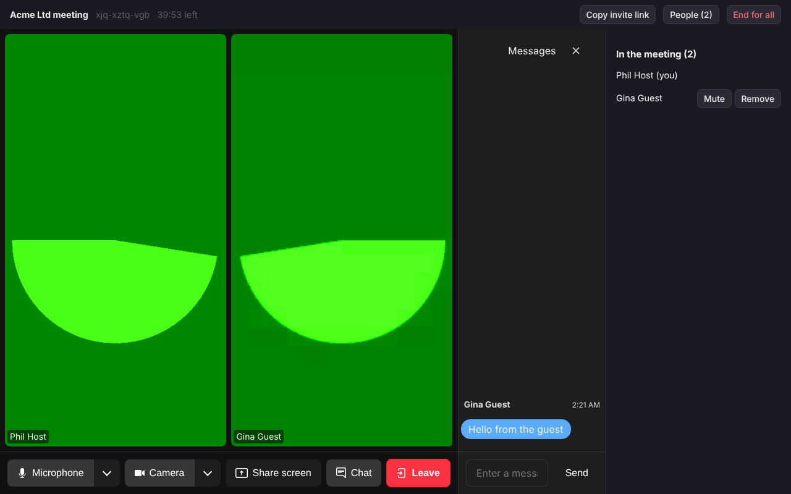

# Mingle

Secure, reliable video meetings for teams. Schedule a meeting, share the link, and meet in
the browser with HD video, screen sharing and chat. Organisations manage members and roles,
and upgrade through Stripe.



## Features

- Multi-party HD video and audio on a LiveKit SFU (simulcast, adaptive streams, 300 people per room on Business)
- Screen share with audio, in-meeting chat, device selection and preview
- Instant and scheduled meetings, shareable links, add-to-calendar (.ics)
- Guests join from the browser without an account; optional waiting room and members-only mode
- Host controls: mute, remove, end for everyone, mute on entry
- Organisations with owner/admin/member roles, invitations and an audit log
- Free, Pro and Business plans with server-enforced limits; Stripe Checkout and Customer Portal
- Security: scrypt passwords, server-side sessions, CSRF and rate limiting, strict CSP, signed webhooks

## Quick start

```bash
docker compose up --build
# open http://localhost:3000
```

For development with hot reload, tests and production deployment see
[docs/DEPLOYMENT.md](docs/DEPLOYMENT.md). How it works: [docs/ARCHITECTURE.md](docs/ARCHITECTURE.md).
What's next: [docs/ROADMAP.md](docs/ROADMAP.md).

## Project layout

```
apps/server   Fastify API, Postgres schema and migrations, integration tests
apps/web      React app (dashboard, meeting room, billing)
deploy/       LiveKit development config
docs/         Architecture, deployment and roadmap
```

The previous 3D avatar prototype lives in git history (before this rewrite) and is on the
roadmap as an optional premium "Spaces" feature.
